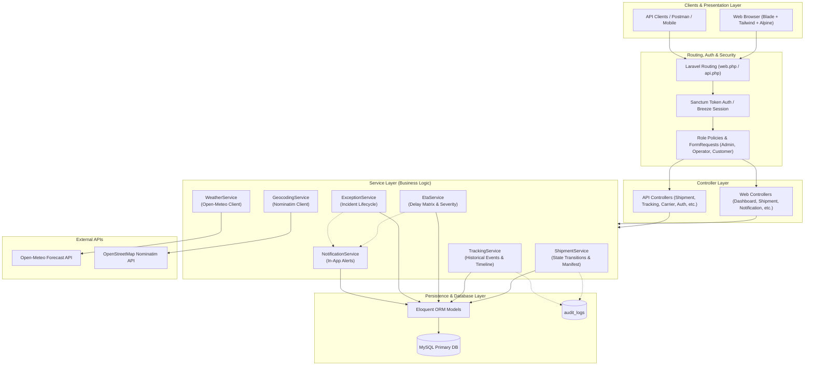
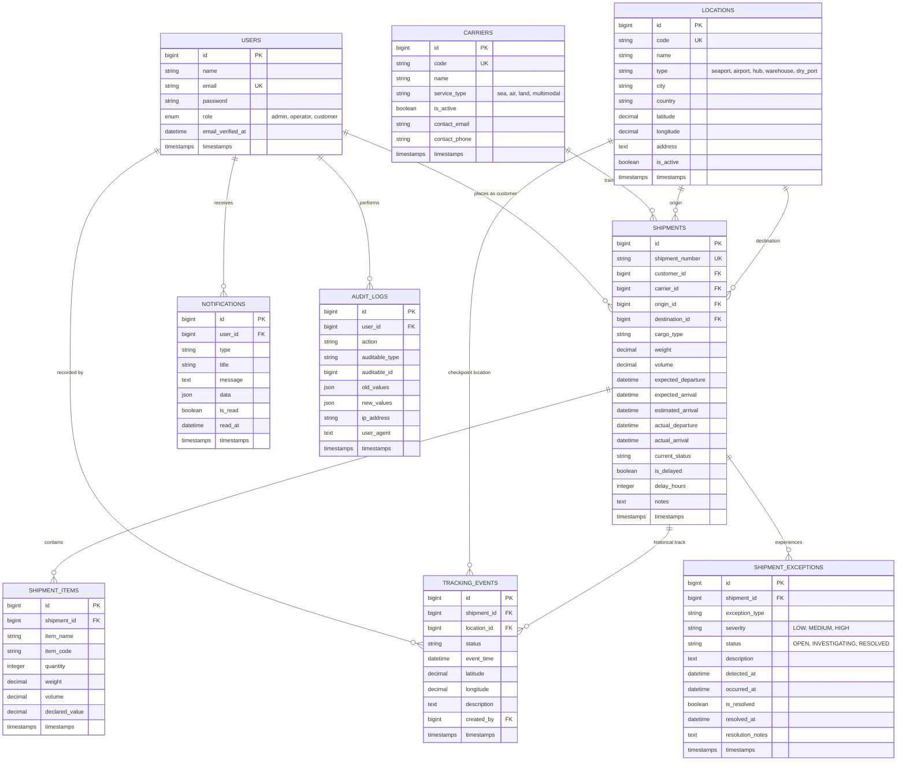

# CargoTrace - Intelligent Logistics & Shipment Tracking Platform

> **A modern, enterprise-ready logistics platform built with Laravel 12, Tailwind CSS, Leaflet.js, and Chart.js.**  
> Features strict role-based access control (RBAC), deterministic shipment lifecycle transitions, intelligent ETA/delay severity engine, historical GPS tracking, external weather & geocoding integrations, and a production-grade Sanctum REST API.

---

## 📌 Project Overview

**CargoTrace** is a comprehensive multi-tier logistics and cargo tracking web application and API engine. Designed for logistics enterprises, freight forwarders, and end customers, CargoTrace provides real-time visibility into multi-modal shipments (sea, air, land), cargo condition monitoring, automated exception handling, interactive geospatial maps, and predictive delay analytics.

The application adheres to clean architecture principles by decoupling business logic into a dedicated **Service Layer**, enforcing strict database constraints, providing in-app customer notifications, and offering a fully tested JSON REST API with complete Postman documentation.

---

## 💡 Problem & Solution

### The Problem
Traditional supply chain and freight management systems frequently face:
1. **Opaque Status Updates**: Shipments make unpredictable status jumps or fall back into impossible statuses (e.g., delivered cargo reverting to in-transit).
2. **Delayed Exception Recognition**: Port congestion, customs inspections, and adverse weather events are detected too late, leaving customers uninformed.
3. **Lack of Integrated Geospatial & Environmental Context**: Disconnected tracking systems fail to correlate container coordinates with live weather conditions.
4. **Poor Role Boundaries**: Customers accidentally view other clients' confidential manifest details, or operators unintentionally modify critical system configurations.

### The Solution
CargoTrace addresses these challenges through:
- **Deterministic Lifecycle State Machine**: Enforces a strict linear sequence (`CREATED` &rarr; `BOOKED` &rarr; `PICKED_UP` &rarr; `IN_TRANSIT` &rarr; `DELIVERED`). Terminal statuses (`DELIVERED`) cannot be tampered with.
- **Rule-Based Delay & Severity Engine**: An automated `EtaService` compares estimated arrival against expected schedule, categorizes delays into `LOW`, `MEDIUM`, or `HIGH` severity based on configurable threshold rules, and alerts stakeholders.
- **Unified Chronological Timeline & Interactive Leaflet Maps**: Visualizes checkpoints, coordinates, and incidents on OpenStreetMap with official attribution, coupled with live weather feeds from Open-Meteo.
- **Strict Multi-Tenant RBAC Policies**: Server-side Laravel Policies ensure customers only access their own shipments, operators manage logistics operations, and administrators retain governance over master data and audit trails.

---

## 🚀 Key Features

- **Operational Dynamic Dashboard & Executive KPIs**:
  - Aggregated real-time metrics directly from MySQL (Total Shipments, In Transit, Delivered, Delayed, Open Exceptions).
  - Executive Operational KPIs: **On-Time Delivery Rate (%)**, **Average Delay Duration (hours)**, and **Average Exception Resolution Time (hours)**.
  - Delay Rate (%) and Exception Rate (%) KPIs.
  - Interactive **Chart.js** data visualizations: *Shipment by Status* (Doughnut) and *Shipment by Carrier* (Bar).
  - Multi-corridor route scenarios: **Southeast Asia &rarr; Europe**, **Asia &rarr; North America**, and **Southeast Asia &rarr; Australia**.
  - Role-scoped metrics (global for Admin/Operator, private for Customer).
- **Shipment Management with Advanced Multi-Filter**:
  - Live search across shipment numbers, cargo types, and manifest item descriptions.
  - Granular filters by carrier, status, origin, destination, date range, and delay state.
  - Server-side sorting and pagination with retained query strings.
- **Deterministic State Machine & Historical Tracking**:
  - `ShipmentService` prohibits illegal state transitions or out-of-order jumps.
  - `TrackingService` appends historical checkpoints with coordinates, timestamps, and author identities without overwriting past history.
  - Comprehensive `AuditLog` records actor, action, timestamp, old values, and new values for every critical operation.
- **Exception & Incident Management**:
  - Track logistical exceptions (`CUSTOMS_HOLD`, `WEATHER_DELAY`, `PORT_CONGESTION`, `DAMAGED`, `MISROUTED`, `DOCUMENTATION_ISSUE`).
  - Status lifecycle: `OPEN`, `INVESTIGATING`, `RESOLVED` with detection and resolution timestamps.
- **Interactive Maps & Weather Intelligence**:
  - **Leaflet.js + OpenStreetMap** route and checkpoint visualization with markers, polylines, and popups.
  - **Open-Meteo API** integration for live weather conditions (temperature, wind speed, weather code interpretation) at destination/checkpoints with timeout and graceful fallbacks.
  - **Nominatim Geocoding API** for reverse geocoding GPS coordinates.
- **In-App Customer Notifications**:
  - Automated notification triggers for status transitions, delay alerts, and newly logged exceptions.
  - Dynamic bell notification counter badge in the navigation bar.
  - Notification management center (mark individual or all as read).
- **Full REST API (Laravel Sanctum)**:
  - Token-based authentication (`/api/register`, `/api/login`, `/api/logout`, `/api/user`).
  - Paginated CRUD endpoints for Shipments, Items, Tracking, Carriers, Locations, and Exceptions.
  - Consistent JSON error formatting (200, 201, 401, 403, 404, 422) without leaking server stack traces.

---

## 🛠 Tech Stack

| Layer | Technology |
|---|---|
| **Backend Framework** | Laravel 12 (PHP 8.2+) |
| **Authentication & API** | Laravel Breeze, Laravel Sanctum |
| **Database** | MySQL (Local Production/Demo), SQLite (In-Memory Testing) |
| **Frontend & Styling** | Blade Templates, Tailwind CSS, Alpine.js |
| **Data Visualization** | Chart.js 4.x |
| **Maps & Geospatial** | Leaflet.js 1.9+, OpenStreetMap Tiles |
| **External APIs** | Open-Meteo Weather API, Nominatim OSM Reverse Geocoder |
| **Testing** | PHPUnit 11 / Pest, RefreshDatabase |

---

## 🏛 Architecture Diagram



---

## 🗄 Database ERD & Data Dictionary

### Entity-Relationship Diagram (ERD)



### Data Dictionary Summary

| Table | Primary Purpose | Key Fields & Constraints |
|---|---|---|
| `users` | User credentials and role management | `id` (PK), `email` (Unique), `role` (`admin`, `operator`, `customer`). |
| `carriers` | Freight companies and shipping lines | `code` (Unique), `name`, `service_type` (`sea`, `air`, `land`, `multimodal`). |
| `locations` | Origin, destination, and checkpoint facilities | `code` (Unique), `name`, `city`, `country`, `latitude`, `longitude` (-90 to +90 / -180 to +180). |
| `shipments` | Core cargo consignment record | `shipment_number` (Unique), FKs to users/carriers/locations, `expected_departure`, `expected_arrival`, `estimated_arrival`, `current_status`, `is_delayed`, `delay_hours`. |
| `shipment_items` | Itemized manifests per shipment | `shipment_id` (FK), `item_name`, `quantity`, `weight`, `volume`, `declared_value`. |
| `tracking_events` | Immutable chronological checkpoint log | `shipment_id` (FK), `status`, `event_time`, `latitude`, `longitude`, `description`, `created_by` (FK). |
| `shipment_exceptions` | Logistical incidents and exceptions | `shipment_id` (FK), `exception_type`, `severity` (`LOW`, `MEDIUM`, `HIGH`), `status` (`OPEN`, `INVESTIGATING`, `RESOLVED`), `detected_at`, `resolved_at`. |
| `notifications` | In-app alerts for customers | `user_id` (FK), `type`, `title`, `message`, `is_read`, `read_at`. |
| `audit_logs` | Compliance and security event tracking | `user_id` (FK), `action`, `auditable_type`, `auditable_id`, `old_values`, `new_values`, `ip_address`. |

---

## ⚡ Setup & Installation Guide

### Prerequisites
- **PHP** >= 8.2 (with `pdo_mysql`, `pdo_sqlite`, `curl`, `mbstring`, `xml`, `bcmath` extensions enabled)
- **Composer** >= 2.5
- **Node.js** >= 18.x & **NPM**
- **MySQL** / MariaDB (e.g., via XAMPP or native service on port 3306)

### Step-by-Step Installation

1. **Clone the Repository**:
   ```bash
   git clone https://github.com/tarimurni/uas_cargotrace_laravel.git
   cd uas_cargotrace_laravel
   ```

2. **Install PHP & Node Dependencies**:
   ```bash
   composer install
   npm install
   ```

3. **Configure Environment File**:
   Copy the example configuration file:
   ```bash
   cp .env.example .env
   ```
   Generate the application key:
   ```bash
   php artisan key:generate
   ```

4. **Verify Database Configuration (`.env`)**:
   Ensure MySQL database `cargotrace` exists:
   ```env
   DB_CONNECTION=mysql
   DB_HOST=127.0.0.1
   DB_PORT=3306
   DB_DATABASE=cargotrace
   DB_USERNAME=root
   DB_PASSWORD=

   CARGOTRACE_DELAY_THRESHOLD_HOURS=12

   OPEN_METEO_URL=https://api.open-meteo.com/v1/forecast
   OPEN_METEO_TIMEOUT=3

   NOMINATIM_URL=https://nominatim.openstreetmap.org
   NOMINATIM_TIMEOUT=3
   NOMINATIM_USER_AGENT="CargoTrace-Logistics/1.0 (contact@cargotrace.com)"
   ```

5. **Run Migrations & Seeders**:
   ```bash
   php artisan migrate:fresh --seed
   ```

6. **Build Frontend Assets**:
   ```bash
   npm run build
   # or for development:
   # npm run dev
   ```

7. **Serve the Application**:
   ```bash
   php artisan serve
   ```
   Open your browser at `http://127.0.0.1:8000`.

---

## 🧪 Running Tests

CargoTrace includes a comprehensive suite of **144 automated unit and feature tests (523 assertions)** covering authentication, authorization, CRUD validation, state transitions, delay matrices, and API endpoints.

To safeguard local MySQL demo data, the test suite is configured in [phpunit.xml](file:///c:/xampp/htdocs/cargotrace/phpunit.xml) to execute against an **isolated in-memory SQLite database** (`:memory:`):

```bash
php artisan test
```

### Targeted Test Commands:
```bash
# Run Auth Acceptance Tests
php artisan test --filter=AuthFeatureTest

# Run Role-Based Authorization Tests
php artisan test --filter=AuthorizationFeatureTest

# Run Shipment CRUD & 422 Validation Tests
php artisan test --filter=ShipmentCrudValidationTest

# Run Lifecycle & State Machine Tests
php artisan test --filter=LifecycleAndTrackingTest

# Run ETA Delay & Severity Engine Tests
php artisan test --filter=EtaDelayFeatureTest
```

---

## 👥 Demo Accounts

The database seeder provisions 3 realistic accounts representing the core platform personas:

| Role | Email | Password | Permissions & Scope |
|---|---|---|---|
| **Administrator** | `admin@cargotrace.com` | `password` | Full system access. Manages carriers, locations, global audit logs, and monitors all shipments. |
| **Logistics Operator** | `operator@cargotrace.com` | `password` | Creates & edits shipments, syncs manifest items, logs tracking checkpoints & exceptions, views global shipments. |
| **Customer** | `customer@cargotrace.com` | `password` | View-only access strictly restricted to own shipments. Accesses route maps, condition reports, and in-app notifications. |

---

## 📡 API Endpoints Summary

All API endpoints are protected using **Laravel Sanctum Bearer Tokens** (except public auth routes) and return consistent JSON payloads with standard HTTP status codes.

A complete Postman Collection is available in the repository at:  
👉 [`docs/CargoTrace.postman_collection.json`](file:///c:/xampp/htdocs/cargotrace/docs/CargoTrace.postman_collection.json)

### Endpoint Directory

| Method | Endpoint | Description | Role / Auth |
|---|---|---|---|
| `POST` | `/api/register` | Register a new user | Public |
| `POST` | `/api/login` | Authenticate and issue Sanctum token | Public |
| `POST` | `/api/logout` | Revoke current user's token | Bearer Token |
| `GET` | `/api/user` | Retrieve authenticated user profile | Bearer Token |
| `GET` | `/api/shipments` | Paginated list of shipments (filtered & scoped) | All Authenticated |
| `POST` | `/api/shipments` | Create new shipment with items (validates 422) | Operator, Admin |
| `GET` | `/api/shipments/{id}` | Detailed shipment information & manifest | Owner / Operator / Admin |
| `PUT/PATCH` | `/api/shipments/{id}` | Update shipment or execute valid status transition | Operator, Admin |
| `DELETE` | `/api/shipments/{id}` | Soft/hard delete shipment | Admin Only |
| `GET` | `/api/shipments/{id}/tracking` | Chronological tracking timeline | Owner / Operator / Admin |
| `POST` | `/api/shipments/{id}/tracking` | Append new GPS checkpoint & update status | Operator, Admin |
| `GET` | `/api/carriers` | Paginated list of active freight carriers | Operator, Admin |
| `POST` | `/api/carriers` | Register a new freight carrier | Admin Only |
| `GET` | `/api/locations` | Paginated list of seaports, airports & hubs | Operator, Admin |
| `POST` | `/api/locations` | Register a new logistics location | Admin Only |
| `POST` | `/api/shipments/{id}/exceptions` | Report a logistics exception (weather, customs, etc.) | Operator, Admin |
| `PATCH` | `/api/exceptions/{id}` | Update exception status (`OPEN` &rarr; `RESOLVED`) | Operator, Admin |

---

## ⚠️ Known Limitations & Future Work

### Current Limitations
1. **Synchronous Weather Calls**: External API queries (Open-Meteo & Nominatim) execute synchronously with short timeouts (3s) and fallbacks. High-latency networks may experience a minor delay on shipment detail load if caching is omitted.
2. **Mock GPS Streaming**: Tracking event coordinates are currently added via operator form or API endpoints rather than direct hardware IoT sensor telemetry (MQTT/LoRaWAN).
3. **Simulated Multi-Carrier EDI**: Carriers are modeled internally within CargoTrace rather than via external EDI 214 / 315 protocols.

### Future Work & Roadmap
- **Real-Time WebSockets**: Transition in-app notifications and timeline checkpoints to Pusher / Laravel Reverb for zero-refresh updates.
- **Automated Weather Crons**: Background workers periodically polling routes against global weather grid models to predict delays hours before vessels enter storm fronts.
- **Export Engine**: Exporting shipment histories, proof-of-delivery (POD) receipts, and customs manifests into standardized PDF & Excel reports.
- **IoT Telemetry Gateway**: Direct ingestion endpoint for IoT container smart seals (temperature, humidity, shock, GPS ping).

---

## 📜 Attributions & Third-Party Libraries

CargoTrace proudly builds upon open-source software and open web services:

- **[Laravel Framework](https://laravel.com/)**: Expressive PHP web framework (Taylor Otwell and contributors).
- **[Tailwind CSS](https://tailwindcss.com/)**: Utility-first CSS framework (Tailwind Labs).
- **[Leaflet.js](https://leafletjs.com/)**: Open-source JavaScript library for interactive maps (Vladimir Agafonkin and contributors).
- **[OpenStreetMap](https://www.openstreetmap.org/)**: Map data &copy; OpenStreetMap contributors under the Open Database License (ODbL).
- **[Chart.js](https://www.chartjs.org/)**: Flexible JavaScript charting library for designers and developers.
- **[Open-Meteo](https://open-meteo.com/)**: Open-source weather API providing free, accurate meteorological data.
- **[Nominatim](https://nominatim.org/)**: Open-source search and reverse geocoding engine using OpenStreetMap data.

---

<p align="center">
  <b>Developed for CargoTrace Logistics Management &bull; 2026</b>
</p>
